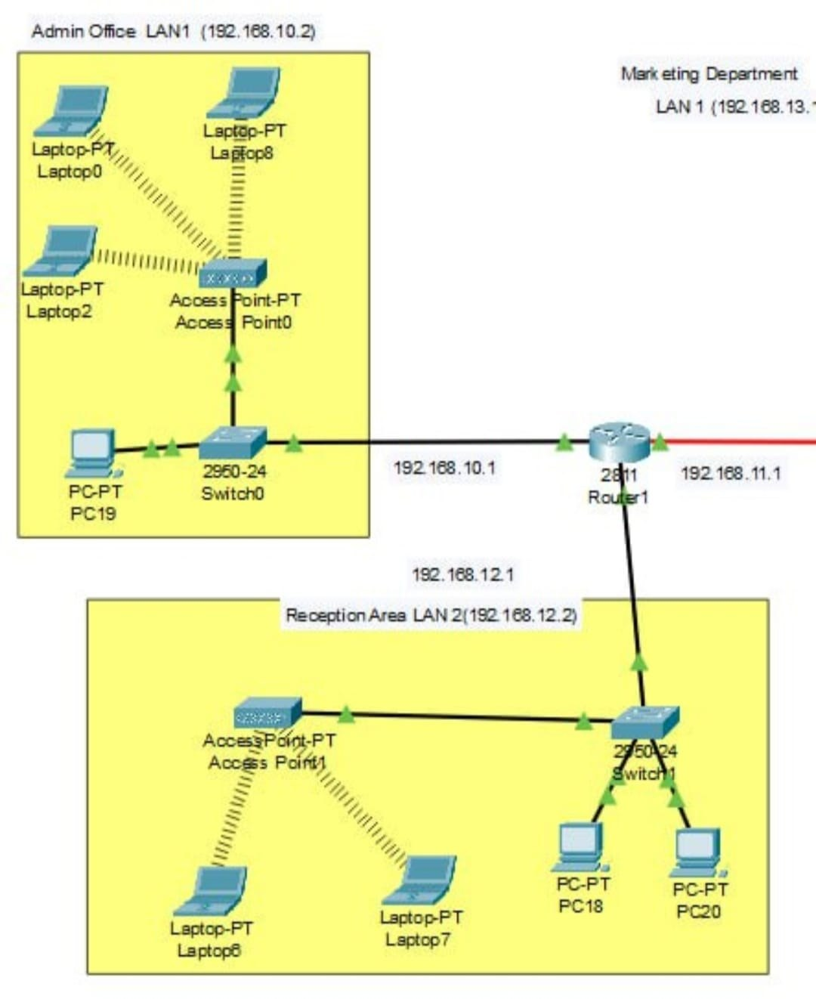
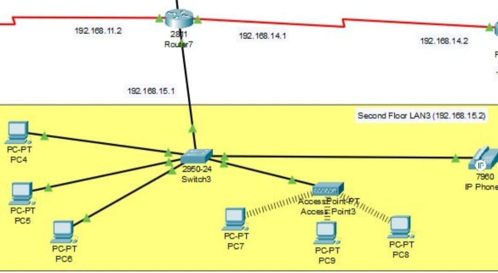
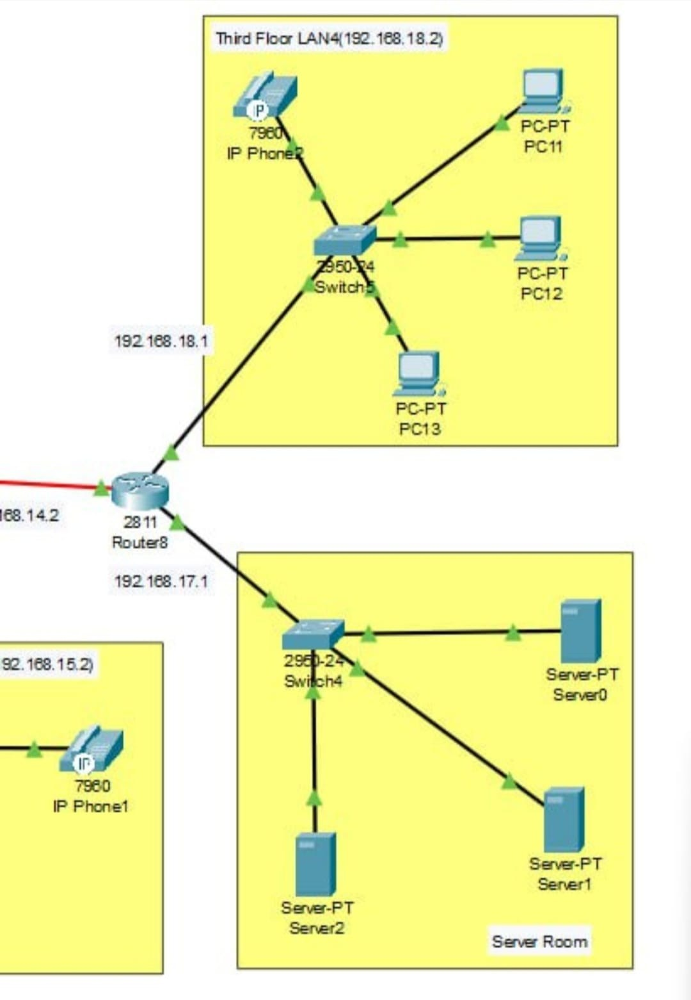

<div align="center">

# 🏨 Hotel Management Network

### Designed and simulated in Cisco Packet Tracer


**Lab project for CSE 321: Computer Networks**
Department of Computer Science and Engineering, Daffodil International University

[🌐 Live Project Website](https://noon131.github.io/Hotel-Management-Network-Cisco-Packet-Tracer/)

Repository maintained by **Mubas Sera Noon**: [GitHub @Noon131](https://github.com/Noon131)

</div>

---

## 📑 Table of Contents

- [Overview](#-overview)
- [Topology](#-topology)
- [Features](#-features)
- [Network Zones and Subnets](#-network-zones-and-subnets)
- [VLANs](#-vlans)
- [Key Interface Addresses](#-key-interface-addresses)
- [Technologies](#%EF%B8%8F-technologies)
- [Getting Started](#-getting-started)
- [Project Structure](#-project-structure)
- [Limitations](#%EF%B8%8F-limitations)
- [Future Improvements](#-future-improvements)
- [Team](#-team)
- [Acknowledgements](#-acknowledgements)
- [License](#-license)

---

## 📖 Overview

This project is a complete hotel network infrastructure designed and simulated in **Cisco Packet Tracer**. Every department and floor has its own VLAN and subnet, routers connect the whole building, DHCP assigns IP addresses automatically, and the network supports wireless access points and VoIP IP phones.

**Objectives**

- Separate departments logically using multiple VLANs
- Give laptops and mobile devices mobility through wireless access points
- Provide internal voice communication with VoIP IP phones
- Assign IP addresses automatically with DHCP
- Achieve full connectivity between all departments using routers and switches
- Use a hierarchical topology that is easy to scale and maintain

---

## 🗺️ Topology

[](IMG/project%20ss.jpg)

*Click the image to view it in full size.*

### Detailed views

| Admin Office and Reception Area | Second Floor |
|:---:|:---:|
| [](IMG/admin-reception.jpg) | [](IMG/second-floor.jpg) |

| Third Floor and Server Room |
|:---:|
| [](IMG/third-floor-server-room.jpg) |

---

## ✨ Features

| | Feature |
|---|---|
| 🧩 | **VLANs** to separate each department and floor |
| 🔀 | **Cisco 2811 routers** connecting departments and floors |
| 🔌 | **Cisco 2950 switches** for LAN connectivity inside each department |
| 📡 | **DHCP** for automatic IP address assignment |
| 📶 | **Wireless access points** in the Admin Office, Reception and Second Floor |
| ☎️ | **VoIP IP phones** in the IT Department, Second Floor and Third Floor |
| 🏗️ | **Hierarchical design** that is easy to scale and maintain |

---

## 🌐 Network Zones and Subnets

| Zone | Network | Subnet | Devices |
|------|---------|--------|---------|
| Admin Office | LAN 1 | `192.168.10.0/24` | Laptops, PC, Access Point |
| Reception Area | LAN 2 | `192.168.12.0/24` | PCs, Access Point |
| Marketing Department | LAN 1 | `192.168.13.0/24` | PCs |
| IT Department | LAN 2 | `192.168.19.0/24` | PCs, IP Phone |
| Second Floor | LAN 3 | `192.168.15.0/24` | PCs, Access Point, IP Phone |
| Third Floor | LAN 4 | `192.168.18.0/24` | PCs, IP Phone |
| Server Room | Internal LAN | `192.168.17.0/24` | Servers |

---

## 🧰 VLANs

| VLAN ID | Department |
|:-------:|------------|
| 10 | Admin Office |
| 12 | Reception |
| 13 | Marketing |
| 15 | Second Floor |
| 17 | Server Room |
| 18 | Third Floor |
| 19 | IT Department |

---

## 🔗 Key Interface Addresses

| IP Address | Interface |
|------------|-----------|
| `192.168.10.1` | Switch0 to Router1 |
| `192.168.11.1` / `192.168.11.2` | Router1 to Router7 link |
| `192.168.12.1` | Reception Area (LAN 2) |
| `192.168.13.1` | Marketing Department (LAN 1) |
| `192.168.14.1` / `192.168.14.2` | Router7 to Router8 link |
| `192.168.15.1` | Second Floor (LAN 3) |
| `192.168.16.1` | First Floor segment |
| `192.168.17.1` | Router8 (Server Room) |
| `192.168.18.1` | Switch5 to Router8 (Third Floor) |
| `192.168.19.1` | IT Department (LAN 2) |

---

## 🛠️ Technologies

| Technology | Purpose |
|------------|---------|
| **VLAN** | Logical segmentation of the network |
| **DHCP** | Automatic IP address assignment |
| **Wireless (Access Points)** | Wireless connectivity for laptops and mobile devices |
| **VoIP (IP Phones)** | Internal voice communication |
| **Cisco 2950 Switch** | LAN connectivity inside departments |
| **Cisco 2811 Router** | Routing between VLANs and floors |

---

## 🚀 Getting Started

### Prerequisites

- [Cisco Packet Tracer](https://www.netacad.com/courses/packet-tracer) (a free Cisco Networking Academy account is required to download it)
- A modern web browser, to view the project website

### View the simulation

1. Clone the repository
   ```bash
   git clone https://github.com/Noon131/Hotel-Management-Network-Cisco-Packet-Tracer.git
   cd Hotel-Management-Network-Cisco-Packet-Tracer
   ```
2. Open the project's `.pkt` file in Cisco Packet Tracer.
3. Use the **Ping** tool or the **Simulation** mode to test connectivity between departments, for example from an Admin Office PC to a Server Room server.
4. Open a DHCP-enabled PC, go to **Desktop → IP Configuration**, and confirm it receives an address from its department subnet.

### View the website locally

Open `index.html` in any browser, or visit the [live site](https://noon131.github.io/Hotel-Management-Network-Cisco-Packet-Tracer/).

---

## 📁 Project Structure

```
Hotel-Management-Network-Cisco-Packet-Tracer/
├── index.html    # Project showcase website (topology, subnets, VLANs, team)
├── IMG/          # Topology screenshot and detailed views
├── LICENSE       # MIT License
└── README.md     # Project documentation
```

---

## ⚠️ Limitations

This is an academic lab project, so please keep the following in mind:

- **Simulation only.** The network was built and tested in Cisco Packet Tracer. It has not been deployed or tested on real hardware, and Packet Tracer does not support every feature of real Cisco IOS.
- **Small scale.** The design covers a limited number of devices per department and is not sized for a full production hotel with hundreds of rooms and guests.
- **No internet or WAN connectivity.** The project covers the internal network only. There is no ISP link, NAT, or external routing.
- **Limited security.** Inter-VLAN traffic is not restricted by access control lists (ACLs), and features such as port security, VLAN hardening, and wireless encryption policies are not part of the scope. Guest and staff traffic are not isolated beyond VLAN separation.
- **No redundancy.** Departments connect through a single path, so a failed link or router would cut off the departments behind it. There is no link aggregation, spanning-tree tuning, or failover routing.
- **Basic Quality of Service.** VoIP support is limited to simulated IP phone calls inside the network, with no traffic prioritization or external PSTN/SIP trunk.
- **No network monitoring.** SNMP, syslog, and automated backups are not configured.
- **Naming inconsistencies.** Some zones share the same "LAN" label (for example, Admin Office and Marketing are both called LAN 1), and the First Floor segment (`192.168.16.1`) has no dedicated VLAN entry. VLAN IDs follow the third octet of each subnet for easy reference.

---

## 🔮 Future Improvements

- [ ] Add ACLs to control traffic between departments
- [ ] Add NAT and an internet gateway
- [ ] Introduce redundant links and a dedicated core/distribution layer
- [ ] Separate guest Wi-Fi from staff networks with a dedicated VLAN and WPA2/WPA3
- [ ] Enable port security and DHCP snooping on access switches
- [ ] Add a dedicated VLAN for the First Floor segment
- [ ] Configure QoS for voice traffic
- [ ] Add monitoring (SNMP/syslog) and configuration backups

---

## 👥 Team

| Member | Responsibility |
|--------|----------------|
| **Fahim Montasir** ([@inglorious-star](https://github.com/inglorious-star)) | Server Room and Final Testing |
| **Mst. Tabassum Binte Zia Prova** | VLAN Configuration and Switching |
| **Mubas Sera Noon** ([@Noon131](https://github.com/Noon131)) | DHCP and Wireless Network |
| **Raiyan Jahan** ([@rynrafsan](https://github.com/rynrafsan)) | Network Design and IP Addressing |
| **Md. Ibna Labid** | VoIP Configuration |

---

## 🙏 Acknowledgements

- **Course:** CSE 321: Computer Networks, Section 64_D, Spring 2025
- **Department of Computer Science and Engineering**, Daffodil International University
- Cisco Networking Academy for Cisco Packet Tracer

---

## 📄 License

This project is licensed under the **MIT License**. See the [LICENSE](LICENSE) file for the full text.

You are free to use, copy, modify, and share this project, including for coursework reference, as long as the copyright notice is kept. Please do not submit this work as your own for academic credit; follow your institution's academic integrity policy.

<div align="center">

Made with ❤️ 

</div>
